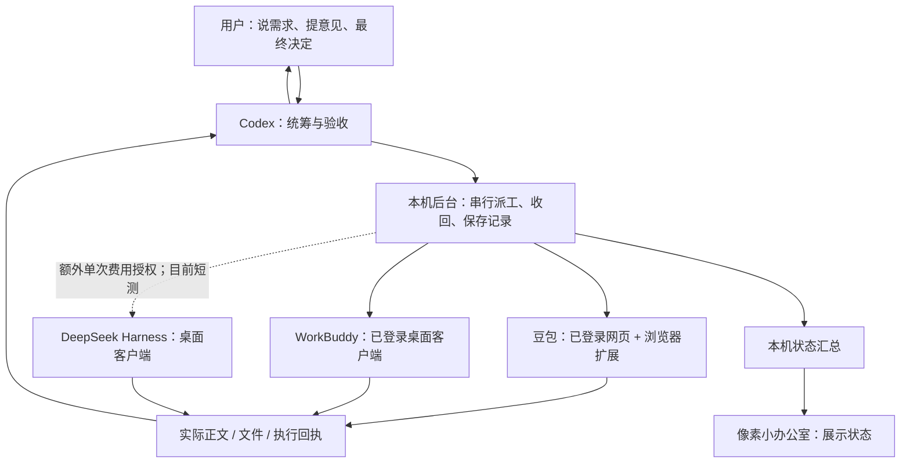

# 小小指挥部 · Multi AI Office

**把 Codex、豆包、WorkBuddy 和 DeepSeek Harness 接进同一个工作流程：人只在一个聊天里说需求，由 Codex 派任务、收结果和验收。**

这是根据个人 Windows 本机原型整理的**方案与 AI 接手文档包**。截至 **2026-11-16**，它记录了实际验证和后续思路，包含合成示例，不包含原型运行源码、登录信息或安装程序。

> 给其他 AI：先读 [AI_START_HERE.md](AI_START_HERE.md)，再看 [project.json](project.json)。本仓库提供理解和复现参考，不能直接启动原型应用。

## 想解决什么

同时使用几个 AI 时，来回切窗口、重复交代背景、复制粘贴成果都很麻烦。这里让 Codex 做统筹，把本次必要的事实、要求和前稿交给适合的工具，再收回实际文字或文件检查。用户负责需求取舍和最后判断。

日常入口在 Codex 聊天里。后台保存任务与成果；桌面可放一个紧凑的像素小办公室，看谁在做、谁已交稿、哪里等着验收。

## 四个 AI 怎么分工

| 成员 | 用途 | 本机原型的实际验证 |
| --- | --- | --- |
| Codex | 理解需求、选择工具、组织材料、派工、检查、交付 | 已用于真实写改稿与文件任务的统筹验收 |
| 豆包 | 起草和修改文案 | 已通过本人登录的 Edge 网页完成写稿、带前稿改稿、自动收回正文 |
| WorkBuddy | 文件、PPT、互动网页和资料处理 | 已完成文档交接；新版已制作教学课件、配对练习和虚拟数据学情报告，并修正过报告 |
| DeepSeek Harness | 可选的备用执行成员 | 已获准用现有余额做过一次短文字连接测试；复杂分工尚未验证 |

目前队列**按步骤串行执行**。四者接入程度不同，没有宣称四个同时自动开工。Harness 是桌面客户端，不能当作普通免费聊天网页。

## 大概怎么连接

Node.js 运行本机连接与队列程序。**Codex 决定做什么，后台按计划执行。** 豆包通过浏览器扩展输入任务、发送并收回回复；WorkBuddy 与 Harness 连接桌面程序的正常页面。各工具不会天然继承彼此的聊天或本地写作规则，相关要求必须随任务传递。

## 一个完整例子

1. 用户在 Codex 里说要写什么，提供必要资料与要求。
2. Codex 把本次适用的事实和写作规则交给豆包。
3. 豆包返回初稿。用户仍在 Codex 里提意见，由 Codex 带前稿再次交给豆包修改。
4. 需要文件时，把实际正文交给 WorkBuddy 整理。
5. Codex 读取真实文件并检查；通过验收后才作为完成结果交给用户。

重点是实际内容交接和验收。一句“完成”或匹配任务编号只能提供部分执行证据，不能证明内容正确。

## 使用原则

- 免费优先。豆包默认用已登录网页，不在失败后自动切付费 API。
- WorkBuddy 按平台账户规则使用，实际积分消耗未全部核清；Harness 使用余额，后续收费任务必须获得相应授权。整套不承诺永久免费。
- 失败、超时或结果不明时暂停并检查原任务，不盲目重发。重启也不自动再提交未确定请求。
- 本人处理登录、验证码和必要授权。不分享账号、Cookie、真实连接密钥、任务历史或私人资料。
- 小办公室展示这套协作的状态，不负责派工，也不监测所有软件和手动工作。

## 已知边界与下一步

已验证的是一台 Windows 电脑上的原型。飞书、金山文档实际读写、跨机器安装、并发与长期稳定性仍未验证。PPT 和互动网页可分别打开，PPT 内自动跳转网页未确认。学情样品使用虚拟数据，不能据此声称真实教学效果。

下一步先整理可迁移配置，再用另一台 Windows 跑通“派任务 → 改稿 → 收文件 → 验收”。通用安装包尚未完成，本仓库不承诺下载即用。

## 阅读导航

| 文件 | 作用 |
| --- | --- |
| [AI_START_HERE.md](AI_START_HERE.md) | 其他 AI 的快速理解与接手说明 |
| [project.json](project.json) | 机器可读的目标、成员、原则和文档索引 |
| [docs/architecture.md](docs/architecture.md) | 模块、连接机制与原工程对应文件 |
| [docs/workflow-and-states.md](docs/workflow-and-states.md) | 任务交接、状态、验收和异常处理 |
| [docs/verified-and-limits.md](docs/verified-and-limits.md) | 已验证、未验证和费用边界 |
| [docs/reproduction-and-sharing.md](docs/reproduction-and-sharing.md) | 复现与交给别人使用的步骤 |
| [examples/README.md](examples/README.md) | 合成计划、结果和状态示例 |
| [THIRD_PARTY_NOTICES.md](THIRD_PARTY_NOTICES.md) | 参考来源与第三方素材范围 |

产品名称用于说明连接对象。角色参考图、头像、真实界面截图与个人写作档案均未包含。
