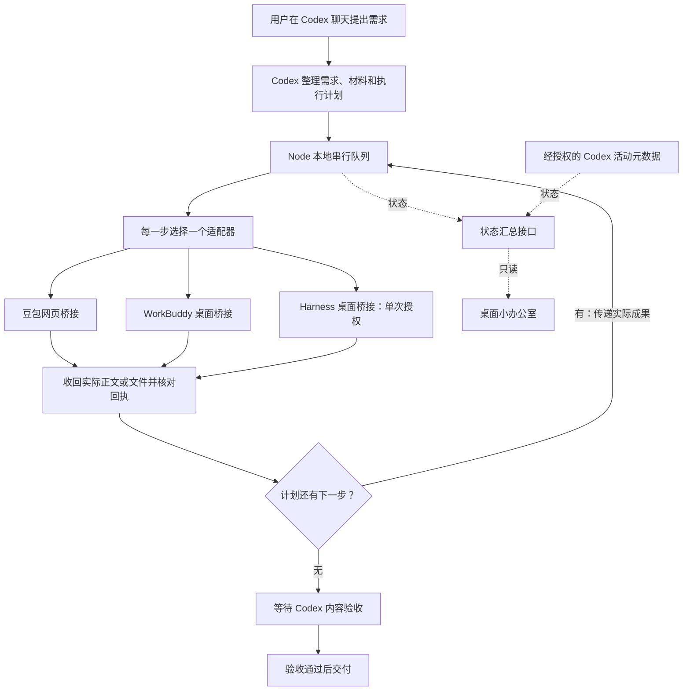

# 架构：由 Codex 组织的四个 AI 协作

核对日期：2026-11-16。

本仓库只提供方案文档和合成示例。原型工程源码、账号配置、运行记录和真实成果均未包含；文中的文件名、接口和端口用于解释原型，不表示克隆本仓库后就能运行这些程序。当前没有通用安装包。

## 目标与四者分工

用户在 Codex 聊天中提出需求，由 Codex 整理材料、安排执行步骤、收回成果并检查。需要修改时，把已有正文和明确意见交给相应工具，用户不必在几个应用之间反复复制需求。

| 角色 | 在原型中的职责 | 当前验证范围 |
|---|---|---|
| Codex | 理解需求、选择工具与规则、生成计划、处理异常、核对内容、组织交付 | **已验证**：文案、文件交接和教学样品的组织与验收 |
| 豆包 | 通过已登录网页起草文案、携前稿改写 | **已验证**：多轮真实写稿与改稿，实际正文自动收回 |
| WorkBuddy | 在独立任务目录内处理本地文件，生成文档、课件和练习 | **已验证**：新版完成三类教学样品及一次报告修正 |
| DeepSeek Harness | 通过已登录桌面客户端接收明确批准的任务 | **已验证**：一次现有余额短文字测试；**未验证**：复杂分析、文件操作和长任务 |

原型不是每个需求都固定调用四者。Codex 按需求选择必要步骤；目前执行队列一次只运行一个步骤。

## 决策层与执行层分开

**Codex 是决策层。** 它在聊天中决定需求是否清楚、哪些材料需要传递、该使用哪个工具以及结果是否合格。适用的写作规则必须作为实际文字传入；豆包不会因为收到一个本机文件路径，就自动获得文件内容或继承 Codex 的 Skill。

**Node.js 程序是执行层。** 原型中的本地服务读取已经形成的计划，保存任务状态，依次调用适配器，收取文件与回执。它本身不理解自然语言需求，不负责生成计划，也不是一个会自行找任务、不断调用模型的常驻总控 AI。

图中的三个工具分支表示可选择的路线，不表示同时执行。前一步回执和文件检查通过后，可以自动进入后一步；此时内容仍可能尚未经过 Codex 的最终审稿。

## 三条连接路线

### 豆包：浏览器扩展连接网页

本地包装程序连接项目内桥接服务，由扩展在接收者已经登录的 Edge 中准备独立任务标签页、输入要求、发送一次并等待正文完成。收回文字保存为 `final.md`，另存结构化回执。浏览器登录资料由浏览器管理，不导出 Cookie。

这条路线使用豆包网页账号，不调用火山付费 API。免费额度、登录和使用限制仍取决于账号；扩展显示已连接，只能证明连接存在，不能预先证明当前一定能完成任务。本地桥接还需要自己的连接密钥，复现时应重新生成，不能复制他人的实际配置。

### WorkBuddy：正常桌面页面与任务目录

适配器连接已核实的本机桌面页面，检查正在执行的任务、未发送草稿和弹窗，通过正常界面新建任务、选择独立目录并发送。Windows 目录对话框另由原生辅助程序处理，先核对所属应用和控件，再选择本次目录。

任务材料放在 `input.json`；要求应用在同一目录写入成果和 `result.json`。收回时检查任务编号、随机校验码、文件存在性、大小及路径范围，拒绝链接或目录逃逸。校验码证明归属，内容质量仍须审核。

### DeepSeek Harness：受单次授权约束的桌面路线

适配器操作已登录 Harness 的正常桌面页面，不通过导出账号密钥或私有 IPC 派工。当前实现仅放行明确批准的现有余额小测试：计划携带授权编号，包装程序检查本地授权是否真实、有效、未消费且范围匹配，发送前排他记录消费。

仅在计划里填一个编号不会产生授权；消费后失败也不会自动释放或重发。收回的是本轮最终助手正文，不把思考或用户输入当作交付结果。当前没有硬费用封顶，也不能把普通免费聊天网页的能力视为 Harness 已验证能力。

## 办公室是显示层

原型的 Windows WPF 浮窗约每两秒读取一次 `/api/office`。它显示人物、状态与简短任务说明，可拖动、收起、置顶和查看任务；浮窗不发模型请求，关闭浮窗也不终止派工后台。

- 工具工位：依据本项目队列步骤和连接状态，不监测所有手动网页或客户端任务。
- Codex 工位：经用户批准并正常信任的本机 Hooks 汇总同一用户配置下的会话活动；原单条会话读取器只保留为明确忙碌的兜底。
- 内部协作者：由 Codex 显式登记开始与结束，不能仅添加一个工位就获得执行能力。

跨聊天 Hooks 只保留事件、会话与轮次编号、时间等元数据，不保存聊天正文、推理或工具参数。它们不是派工接口，响应结束也不等于业务成果已经验收。

## 原型实现索引

下表只是原工程文件名映射，**本仓库不包含这些源码**。复现者需要自行实现对应模块，不能直接运行这些原型入口。

| 模块 | 原工程关键文件名 |
|---|---|
| 计划入口、队列与本机服务 | `workbench.mjs`、`workbench/core.mjs`、`workbench/executors.mjs`、`workbench/server.mjs` |
| 豆包网页包装与第三方桥接 | `doubao_web_bridge.mjs`、`external/codex-doubao-bridge/` |
| WorkBuddy 通用派工 | `workbuddy_task.mjs`、`workbuddy_page.mjs`、`workbuddy_select_folder.ps1` |
| WorkBuddy 历史计算探针 | `workbuddy_bridge.mjs`，不是通用执行器入口 |
| Harness 单次授权派工 | `deepseek_harness_bridge.mjs`、`deepseek_harness_page.mjs` |
| 状态汇总与活动来源 | `workbench/office-state.mjs`、`workbench/codex-hook-activity.mjs`、`workbench/codex-activity.mjs`、`office-agent.mjs` |
| 桌面显示与启动 | `desktop_office/OfficeWindow.cs`、`desktop_office/start-office.ps1`、`start-workbench.ps1` |

原型服务仅监听回环地址：任务与状态服务使用 `127.0.0.1:8877`，WorkBuddy 页面连接使用 `127.0.0.1:9227`，Harness 使用 `127.0.0.1:9229`。这些是本地实现选择，不是产品提供的通用远程接口；新实现应核对端口占用、应用身份和页面地址，不对局域网开放。

后续阅读：[工作流与状态](workflow-and-states.md)、[已验证能力与边界](verified-and-limits.md)。
